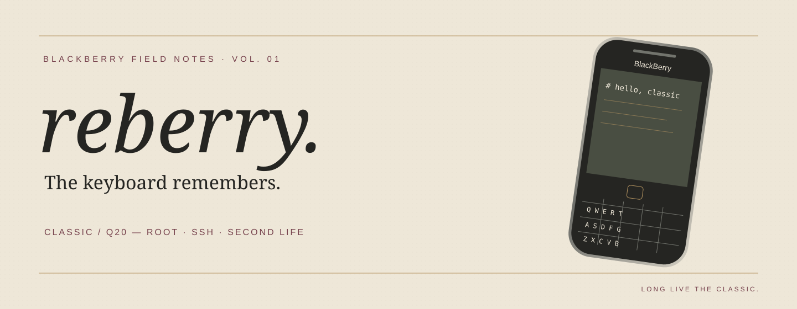

<p align="center"></p>

<p align="center">


</p>

<p align="center"><a href="README.md">English</a> · <a href="README.zh-CN.md">簡體中文</a> · <a href="README.zh-TW.md">繁體中文</a></p>

# reberry

**鍵盤還記得。我們讓系統重新回應。**

一臺 BlackBerry Classic / Q20 的恢復手記：從乾淨刷機，到 root、SSH，再到 Android 設置終於越過進度條。這裏留下 Windows 與 Mac 上實際做過的操作、失敗的線索與可交給下一位 agent 的經驗。

[閱讀雜誌版博客 →](https://eazylee.xyz/reberry/zh-TW/) · [完整操作記錄](docs/windows-field-notes.md) · [複用 skill](skills/blackberry-bb10-recovery/SKILL.md) · [Mac 實測：SSH、BerryCore、Term49](docs/mac-field-notes.md) · [Mac 接棒](docs/mac-handoff.md)

## v3 資源來源

本次使用者從 [BerryLife 的 Pre-rooted Autoloaders v3 頁面](https://bberrylife.github.io/Pages/V3root.html) 取得 v3 工具與刷機資源。該頁提供 v3 工具、原廠 ROM 的入口，並註明原作者 Oleksandr。請透過來源頁面取得資源，本倉庫不託管韌體。

## 本次走通的路徑

```text
匹配設備的 Stock 10.3.3.3216
  → 同源 AutoRoot v3 用戶文件系統
  → 配套 radio
  → 首次啓動與開發模式
  → Term49 / root / 自有 SSH 密鑰
  → 獨立 SSH 服務與可選密碼認證
  → Android 配置權限修復
  → upd 身份提交 PPS 安裝任務
  → 確認 success 後清理傳入的 BAR
```

| 檢查項 | 本次證據 |
| --- | --- |
| Stock、root v3、radio | 三次刷寫均完成；root 更新日誌完成 |
| SSH | 獨立 22 端口可執行遠程命令；密碼認證也完成一次實際登錄 |
| Android Runtime | 系統服務啓動，使用者確認 Settings 能進入頁面 |
| BAR 批量安裝 | 八個任務均返回 `progress::100`、`result::success` |
| 遊戲運行 | 尚未逐個打開驗證，安裝成功不等於運行兼容 |
| 網易雲登錄 | 舊版 APK 可安裝；密碼登錄的服務器錯誤未解決 |

## 三個最值得帶走的細節

1. 本次 v3 腳本檢查 **`/var/rootdata/use.sshd`**。不要照抄 `use.ssh`，先讀你下載版本的啓動腳本。
2. root 不代表安裝器的訪問角色正確。**`/bin/on -u upd /bin/sh`** 能進入安裝器需要的身份。
3. Android 日誌中的 **`skipping insecure file`** 有明確方向：本次將四個配置文件從 777 改成 644、保留所有者後恢復啓動。不要遞歸更改整個 `/apps`。

## 直接複製給 agent

```text
請讀取 https://github.com/EazyLee30/reberry ，先閱讀 README.md
和 skills/blackberry-bb10-recovery/SKILL.md，再根據任務閱讀對應參考文件。
我擁有這臺 BlackBerry 10 設備，請結合我的電腦系統、設備型號、固件版本和實際日誌協助恢復。
先發現工具與當前狀態；不要默認重刷。刷寫前確認我已授權清空數據，以及 stock 與 root 鏡像同源。
使用我自己生成的 SSH 密鑰，憑據僅本地使用。不要發佈密碼、私鑰、設備標識或未脫敏日誌。
按證據區分端口監聽、身份認證、root、Android 服務啓動、安裝成功和應用運行。
完成後記錄實際結果與未解決問題；如果是 Mac，只記錄真正執行過的 Mac 操作，不照搬 Windows 成功結論。
```

博客語言：[English](https://eazylee.xyz/reberry/) · [簡體中文](https://eazylee.xyz/reberry/zh-TW/) · [繁體中文](https://eazylee.xyz/reberry/zh-TW/)。

把倉庫中的 `skills/blackberry-bb10-recovery` 文件夾複製到你所用 agent 的技能目錄即可；Codex 通常使用 `~/.codex/skills/`。也可以直接讓 agent 閱讀文件，無須安裝。

## 閱讀順序

- [Mac：SSH、BerryCore、Term49 實測](docs/mac-field-notes.md)
- [分享预览与响应式布局](docs/site-sharing.md)

- [Windows 實戰：刷寫、SSH、Runtime、PPS](docs/windows-field-notes.md)
- [密碼 SSH 的舊系統兼容分支](skills/blackberry-bb10-recovery/references/password-ssh.md)
- [Mac 後續貢獻說明與複製 prompt](docs/mac-handoff.md)
- [致謝與資料來源](docs/credits.md)

## 隱私與邊界

倉庫僅包含重新撰寫的文字、原創 SVG/PNG 和靜態網頁。固件、遊戲、BAR/APK、SSH 私鑰、設備截圖、完整日誌和賬戶文件均未上傳。示例地址和路徑是佔位符。這裏是單臺設備的現場記錄，不承諾所有固件或舊應用均可運行。復刷會清空數據，應由設備擁有者明確決定；本次使用者已選擇不備份。

默認優先使用自有密鑰認證。密碼分支記錄了歷史系統的 DES 兼容限制，僅供理解問題；請讀其限制，避免把舊 root SSH 暴露到互聯網。

## 致敬

感謝 [BerryCore / sw7ft](https://github.com/sw7ft/BerryCore)、[BerryLife](https://bberrylife.github.io/)、[bb10root](https://github.com/bb10root)、[BerryFarm / Term49](https://github.com/BerryFarm/Term49) 及 BB10 社區的持續工作。感謝 OpenAI 的 ChatGPT 與 Codex 在資料整理、命令分析和執行協作中的幫助。工具、平臺與社區作者保有各自的貢獻；這份記錄沒有把他們的成果歸爲我們的發明。

原創文檔與網頁採用 [CC BY 4.0](https://creativecommons.org/licenses/by/4.0/)。BlackBerry 名稱屬於相應權利人，本項目爲社區記錄，與官方無隸屬關係。
