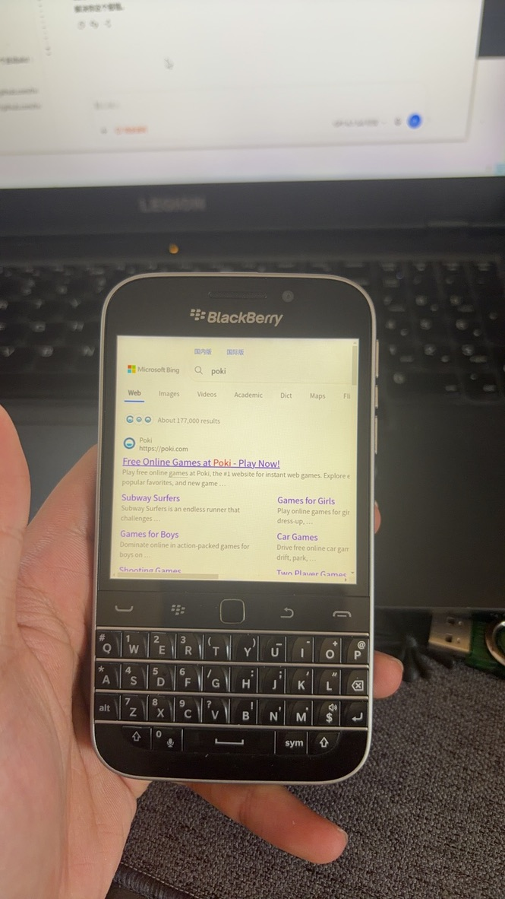
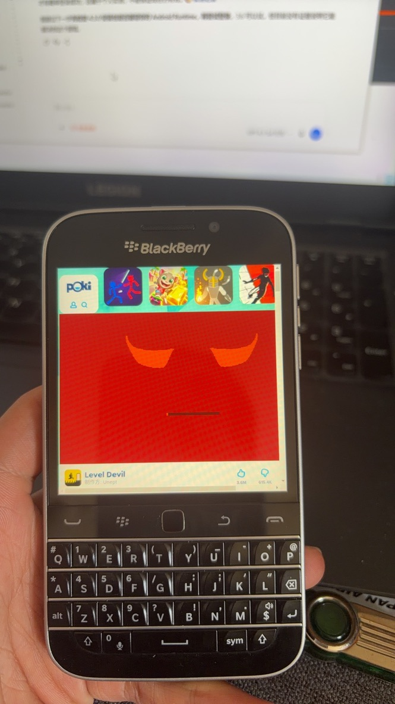
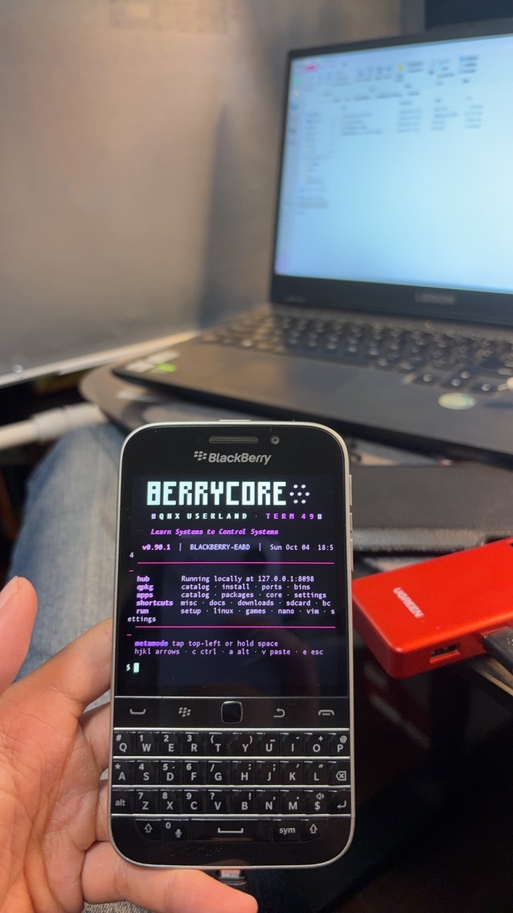

# Classic 恢复全流程：从刷机到日常使用

记录日期：2026-10-11。设备：BlackBerry Classic / Q20。这是一份沿着设备恢复过程连续阅读的现场记录：先在 Windows 完成底层恢复、root、SSH、Android 与应用安装，再在 Mac 上处理 BerryCore、Term49、快捷 SSH 和重启后的文件信任。

两段操作各自保留实际起点：Mac 阶段开始时，拥有者已重新刷机、完成 root 并打开 SSH；不能把此前 Windows 的全部状态自动当作这次 Mac 阶段的状态。Mac 上未执行构建或刷写。下面按恢复流程编排，不把两次操作合称为一套已经完成重启验证的安装方案。

所有命令中的地址、密钥路径与应用后缀均为占位符；凭据和原始日志不公开。资源来自 [BerryLife 的 Pre-rooted Autoloaders v3 指南](https://bberrylife.github.io/Pages/V3root.html)，该页提供工具与原厂 ROM 入口并注明原作者 Oleksandr；本仓库不托管固件。

## 流程目录

1. [底层恢复、root 与首次启动](#stage-01)
2. [SSH 连接与独立服务](#stage-02)
3. [旧系统密码认证](#stage-03)
4. [Android Runtime 权限修复](#stage-04)
5. [上传 BAR 与 PPS 安装](#stage-05)
6. [成功后清理暂存文件](#stage-06)
7. [Mac 接入现有设备](#stage-07)
8. [BerryCore 下载、校验与传输](#stage-08)
9. [解压、路径信任与工具验证](#stage-09)
10. [Term49 自动加载与 SSH 短命令](#stage-10)
11. [欢迎消息、Python 与网页功能](#stage-11)
12. [重启后的信任恢复](#stage-12)
13. [实拍与 BerryBrowser CJK](#daily-use)
14. [当前结果与下一次验证](#next-checks)

电脑只是各阶段使用的工具；设备上的恢复过程才是这份记录的主线。构建与刷写命令使用 PowerShell，后面的传输命令使用 macOS shell，代码块会标出环境。

<a id="stage-01"></a>

## 01 / 先把底座刷对

原先状态是 v3 root 后 SSH 不稳定、Android 应用停在加载页。设备拥有者授权清空、不备份。本次使用适配 Classic 的 Z30 STA100 系列 **10.3.3.3216** 原厂 autoloader，再使用同一份文件生成 v3 镜像。这个包名是本次所用来源，不应单凭文件名判断未知下载安全或硬件兼容。

Windows 准备驱动、可靠 USB 连接、对应 firmware、AutoRoot v3、BB10 MultiTool。检查下载来源和发布说明，并读取 `root_v3.ps1` 的参数：

```powershell
Get-Help .\root_v3.ps1 -Full
Get-Content .\patch.txt
```

在构建前，本次启用了以下 patch 行。版本变化时请先核对启动脚本确实读取这些标志：

```sh
touch /var/rootdata/use.root
touch /var/rootdata/use.sshd
push "patchdata/var/etc/ssh/authorized_keys2" "/var/etc/ssh/authorized_keys2"
chmod 644 "/var/etc/ssh/authorized_keys2"
chown 0:0 "/var/etc/ssh/authorized_keys2"
```

密钥用自己新建的，不沿用工具包中的共享私钥。以下在 Windows 生成一对带口令的 RSA 密钥，将 **`.pub`** 复制进 payload；私钥始终留在电脑：

```powershell
ssh-keygen -t rsa -b 2048 -f "$env:USERPROFILE\.ssh\bb10_lab"
Copy-Item -LiteralPath "$env:USERPROFILE\.ssh\bb10_lab.pub" `
  -Destination '.\patchdata\var\etc\ssh\authorized_keys2'
.\root_v3.ps1 -InputExe 'C:\BB10-Lab\stock-3216.exe' `
  -WorkDir 'C:\BB10-Lab\build'
```

先运行 **stock** autoloader，确认完成；再运行生成的 **root_v3**，完成后运行其 **radio**。分别等待工具结束，不并行、不在刷写中拔线。v3 的 root 包是用户文件系统，不是完整原厂固件；底层必须与构建来源匹配。本次三次均完成，随后 `/tmp/root_update.log` 显示 root 更新完成。

首次开机先到桌面，连电、连 Wi-Fi、打开开发模式；允许所需的第三方安装。给后台初始化留时间，结合日志判断完成，不能仅凭桌面出现或固定 20 分钟认定所有服务健康。

<a id="stage-02"></a>

## 02 / 开发模式和 SSH 是两件事

开发接口可用不意味着 TCP 22 已监听。USB 网络地址在本次不可达，改用手机设置里实际显示的 Wi-Fi 地址。电脑先查端口：

```powershell
Test-NetConnection -ComputerName '<Q20_IP>' -Port 22
.\bb10mt.exe connect --help
```

`bb10mt connect` 在本次早期提供了随连接进程存活的 SSH 通路。它需要设备密码与公钥；按实际版本帮助传参，不在文档、历史记录或公开日志里保存密码。不要把这条临时通路当作开机自启服务。

若已有 Term49 / Term49CX，可在终端中进入 root，手动启动原生服务：

```sh
__root
touch /var/rootdata/use.sshd
/usr/sbin/sshd -e -f /var/etc/ssh/sshd_config -h /var/etc/ssh/ssh_host_rsa_key
```

`-e` 将错误写到终端；需要保持前台诊断时加 `-D`。不要重复启动多个争抢 22 端口的服务。若主机密钥不存在，先检查 `ssh-keygen` 是否可用，再用该设备上的工具生成，不从另一台设备复制主机私钥。

这次遇到的几种错误很直接：

| 报错 | 本次原因 |
| --- | --- |
| `Not a directory` | 将二进制写成 `/usr/sbin/sshd/`，多了末尾斜杠 |
| `No such file or directory` | 路径误写为 `/usr/sbin/sbin` |
| `Bad configuration option: AuthorizedKeyFile` | 正确名称是 **`AuthorizedKeysFile`** |
| `no hostkeys available` | 服务未加载有效主机密钥，需检查路径和权限 |

这台设备的 key 登录示例：

```powershell
ssh -o HostKeyAlgorithms=+ssh-rsa `
    -o PubkeyAcceptedAlgorithms=+ssh-rsa `
    -o MACs=+hmac-sha1 `
    -i "$env:USERPROFILE\.ssh\bb10_lab" root@'<Q20_IP>'
```

兼容选项仅给这一台旧设备使用，不要全局降低其他 SSH 连接配置。第一次连接核对主机指纹，不使用 `StrictHostKeyChecking=no`。

本机部分常见 Unix 命令不在预期路径；`/bin/id`、`/bin/printf` 不可用不能证明 root 失败。用真实命令执行和受限位置写入的权限证据判断。本次已完成 root SSH 远程操作。后来安装阶段设备已重新启动过仍能连接，但没有做一套受控的重启回归检查。

<a id="stage-03"></a>

## 03 / 密码登录是独立的兼容问题

打开 `PasswordAuthentication` 不等于认证实现能够验证当前账户数据库。这台原生 OpenSSH 6.2 没有走通所需 root 密码认证。最终从 BerryCore 包中提取 **原始 OpenSSH 7.1p2** 程序，独立运行；没有把完整 BerryCore 环境先装到手机上。

核心配置使用 `AuthorizedKeysFile`、`PermitRootLogin=yes`、`PasswordAuthentication=yes`、`PermitEmptyPasswords=no`、独立 HostKey 与 PidFile。本次还使用 `UsePrivilegeSeparation=no`。路径信任、QNX 账户 overlay 与哈希格式必须分别处理。详细步骤在 [密码 SSH 参考](../skills/blackberry-bb10-recovery/references/password-ssh.md)。

实测替代服务支持传统 DES crypt，MD5 格式没有成功。最终密码登录通过。这不是建议在新系统使用弱哈希：DES 只考虑密码前八个字节，旧 root 服务只宜在可信局域网实验，密钥登录优先。

<a id="stage-04"></a>

## 04 / Android 进度条背后的权限

Settings BAR 安装后一直留在加载页。通过 `pidin ar` 与 `slog2info` 检查，最初存在 Android init/resmgr 等进程，却没有正常的 zygote/system_server。关键日志摘要：

```text
init: skipping insecure file '.../native/default.cfg'
init: skipping insecure file '.../native/init.cfg'
init: skipping insecure file '/system/build.cfg'
shrimp: Startup timed out. Android file system not ready or Android failed to launch.
```

本次 v3 patch 中包含递归 777；对应配置文件的可写权限过宽。先发现应用目录，不硬编码设备专属后缀：

```sh
/bin/ls -d /apps/sys.android.*/native
```

确认唯一目标后，以实际完整路径代替下方 `<ANDROID_NATIVE>`，检查再仅修正四个文件：

```sh
/bin/ls -l <ANDROID_NATIVE>/default.cfg <ANDROID_NATIVE>/init.cfg <ANDROID_NATIVE>/system/build.cfg <ANDROID_NATIVE>/autolaunch.cfg
/bin/chmod 644 <ANDROID_NATIVE>/default.cfg <ANDROID_NATIVE>/init.cfg <ANDROID_NATIVE>/system/build.cfg <ANDROID_NATIVE>/autolaunch.cfg
```

保留原有所有者，不递归 chown/chmod 全系统。我们停止了日志定位的 Android init 与 shell 进程，让使用者重新打开 Settings；随后 zygote、installd、SystemServer 出现，系统扫描、证书收集和 dexopt 开始运行。首次再次打开仍可能早于应用内部安装完成，应等安装队列完成，再关闭卡片、重新打开。最终使用者确认已经进入设置页面。

本机 build.cfg 显示 **Android 4.3 / API 18 / armeabi-v7a**。root 不会把 Runtime 升级成现代 Android。APK 判断需读取真实包的 minSdk 和 native ABI，不能仅看版本号。网易云旧版可以安装但云端密码登录仍报服务器错误，不能把旧服务认证失败写成 Runtime 已坏。

<a id="stage-05"></a>

## 05 / Windows 上传，QNX 安装器接棒

`scp` 从 Windows 上传 BAR；远端使用简短 ASCII 文件名，避开中文路径处理差异。例如远端暂存为 `/var/rootdata/staged-reader.bar`。安装由 PPS 请求触发：**root SSH 里的默认身份不等于 upd 安装器身份**。

以下是手机侧示例，确认文件已上传并对 upd 可读后执行。任务名每次唯一：

```sh
/bin/chmod 644 /var/rootdata/staged-reader.bar
/bin/on -u upd /bin/sh -c 'echo action::install > /pps/system/installer/upd/current/job.reader-example.bar; echo package_location::/var/rootdata/staged-reader.bar >> /pps/system/installer/upd/current/job.reader-example.bar; echo extras:: >> /pps/system/installer/upd/current/job.reader-example.bar; /bin/chmod 660 /pps/system/installer/upd/current/job.reader-example.bar'
/bin/on -u upd /bin/cat /pps/system/installer/upd/current/job.reader-example.bar
```

等待 `progress::100` **与** `result::success`；Android 包还可能经历 `apk::go` → `apk::done`。别把 PPS 文件已写入当作安装成功。失败时保存脱敏错误摘要，先处理错误，不循环盲目重装。大量包上传与解压争用存储，Asphalt 的大包在本次耗时数分钟。

### 八个实际完成的任务

| 文件标签 | 安装器识别名称 / 版本 | 结果 |
| --- | --- | --- |
| playepub_BB10 | Playepub Book Reader 3.2.1.1 | success |
| PlantsVsZombies | Plants Vs Zombies 1.3.0.1307 | success |
| Cut-the-Rope-2_1.6.3 | Cut the Rope 2 / 1.22.52124.0 | success |
| Asphalt_6_HD | Asphalt 6 / 1.0.2.2 | success |
| Angry-Birds_1.4.1 | Angry Birds **Star Wars** / 1.0.1410.0 | success |
| Angry-Birds_5.0.2 | Angry Birds / 1.0.5020.0 | success |
| 2048_2_0_16 | 2048 / 2.0.16.707 | success |
| Minion-Rush_3.3.0p | Minion Rush / 1.0.33026.0 | success |

此前 BAR Installer、Term49CX、Settings 也已安装。上述只代表安装器完成，未逐个验证游戏启动、画面比例、触控和网络服务。

<a id="stage-06"></a>

## 06 / 可以删安装包，但要删对

成功后删除自己上传的暂存 BAR，不会卸载应用。此次清理了十三份已知成功的暂存文件，释放约 **780 MiB**。保留 AutoRoot 的 `Term49.bar`、`getroot.bar` 等维护 payload；不清扫 `/apps`、应用数据或未知系统暂存文件。

```sh
# 仅在对应任务 result::success 后，删除已知上传的这一份
/bin/rm /var/rootdata/staged-reader.bar
df -h /var/rootdata
```


进入下一阶段时，先重新检查设备状态。以下操作从已刷机、已 root、已打开 SSH 的手机开始，不包含 Mac 刷写验证。宿主为 Apple Silicon（arm64）、macOS 27.0；这些信息在整理时读取。

<a id="stage-07"></a>

## 07 / 从 Mac 连上 QNX

初次连接报 `no matching host key type found`，设备提供 `ssh-rsa`。仅对此连接启用旧主机密钥算法后，密码登录成功；随后使用拥有者提供的本地私钥完成密钥登录。私钥权限原为 640，OpenSSH 拒绝使用，改为 600 后通过。

```sh
chmod 600 "$HOME/.ssh/bb10_lab"
ssh -i "$HOME/.ssh/bb10_lab" \
  -o HostKeyAlgorithms=+ssh-rsa \
  -o PubkeyAcceptedAlgorithms=+ssh-rsa \
  -o ConnectTimeout=10 root@'<BB10_IP>'
```

本次初次接受新主机密钥使用了 `StrictHostKeyChecking=accept-new`，没有独立核对指纹；后续复现应先核对设备指纹。没有为所有主机全局降低 SSH 配置，也没有上传私钥。

远程 `uname -a` 返回 QNX 8.0.0 / armle。原系统 `id` 不在预期路径，不能仅以此否定 root。空间检查显示用户文件系统约有 10 GB 可用。

<a id="stage-08"></a>

## 08 / 下载、校验与传输 BerryCore

从 [BerryCore 官方 v0.90.1 发布](https://github.com/sw7ft/BerryCore/releases/tag/v0.90.1) 下载 `berrycore.zip` 和 `install.sh`。压缩包为 315,029,377 字节；Mac 上计算 SHA-256，与 GitHub 发布 API 的 digest 一致：

```text
berrycore.zip  170dd86b3ef12485540fa0d79ef19ef186442dc91201db82782fb8d7bbcfaa6a
install.sh    452d91947da6cd8e178772dc62f50d9f07670f5e930f73389473cb02a16d8eba
```

通过 SSH 上传到手机的 downloads 暂存目录。使用 `scp -O` 选择传统 SCP 协议；此处没有测试默认 SFTP 是否可用。Wi-Fi 传输约 1 MB/s，这只是本次观察，不是性能承诺。

```sh
scp -O -i "$HOME/.ssh/bb10_lab" \
  -o HostKeyAlgorithms=+ssh-rsa \
  -o PubkeyAcceptedAlgorithms=+ssh-rsa \
  berrycore.zip install.sh root@'<BB10_IP>':/accounts/1000/shared/downloads/berrycore-setup/
```

安装目标为 `/accounts/1000/shared/misc/berrycore`，创建了兼容旧工具的 `misc/clitools` 链接。安装器备份了 root 的 `.profile`，写入新配置、终端主题及 Documents 中的目录指南。没有更换 SSH 服务或重刷系统。

<a id="stage-09"></a>

## 09 / 解压成功，不等于程序可以运行

`sh install.sh`、加载 `env.sh`、部分二进制均报 `Operation not permitted`。增加执行权限、复制脚本到 `/root` 都未解决。将已校验脚本内容送入系统 shell 可以推进主包解压，但加载环境时仍受阻。

Python 3.2 的 `pbpkgadd` 也无法读取运行；最终用系统 `unzip` 逐个展开内置 package，并完成安装器的后续配置。**这是一条现场恢复路径，不是官方安装器完整无误执行的证明。**

发布包内 `packages/gcc.zip` 实为 134 字节 Git LFS 占位文件，不是 ZIP，已跳过。没有安装或验证 GCC；其他包展开完毕并不意味着全部工具可运行。

发现 `/proc/boot/pathtrust` 后，对具体文件设置信任：

```sh
# root shell 中；前缀 ! 表示单个文件，不能省略成整文件系统授权。
/proc/boot/pathtrust '!/accounts/1000/shared/misc/berrycore/env.sh'
```

随后 qpkg help/catalog、Git 2.47.2、curl 8.12.1、nano 7.2、Vim 9.1、zsh 5.0.2、jq 1.6 实际运行通过；curl 对 GitHub HTTPS 请求返回 200。新版 `ls` 和 Bash 仍报错。保留新版 `ls` 为 `ls.berrycore-original`，将 `bin/ls` 链接到 `/bin/ls`，环境中的 ls alias 也切回系统命令。Bash 未修复。

<a id="stage-10"></a>

## 10 / 终端自动加载与 SSH 短命令

用 `pidin` 读取 Term49 shell 环境，确认 HOME 是应用自己的 `data` 目录，**不是 `/root`**。在实际发现的目录写入 `.profile`：

```sh
export BERRYCORE_QUIET=1
export BERRYCORE_MOTD_ENABLED=0
export BERRYCORE_SETUP_AUTO=0
. /accounts/1000/shared/misc/berrycore/env.sh
. /accounts/1000/shared/misc/berrycore/ssh-shortcuts.sh
```

应用目录示例为 `/accounts/1000/appdata/<TERM49_PACKAGE>/data`。写入时使用设备上实际发现的所有者和组，并设置该配置文件的信任。系统 ksh 登录测试确认 NATIVE_TOOLS、qpkg 路径与 Git 可用；Term49 自带 mksh 的远程直接执行被拒绝，因此不能把这次 ksh 测试写成完整应用启动测试。

加入 `sshon` 与 `sshstatus` 两个 shell 函数，调用现有 `/var/rootdata/sshd-password` 和 `/var/etc/ssh/sshd_config`。启动前先用 `sshd-password -t` 检查配置，再检测现有 daemon，避免重复启动。

早期普通用户执行 `pidin ar` 会刷出 `/proc/.../as: Operation not permitted`。后续将检查与启动放进 `/bin/__root`，抑制进程扫描的 stderr，并改用系统 `/usr/bin/grep` 与 shell `print`。远程检查确认能输出 SSH running；**尚未验证重启后普通 Term49 用户首次执行整条启动路径**。进程存在也不等于认证成功：本次曾遇到 22 端口接受后立即关闭连接，后来实际 SSH 登录恢复。

<a id="stage-11"></a>

## 11 / 欢迎消息、Python 和网页目录

远程 MOTD 请求返回 `404: Not Found`，已把 env.sh 的 MOTD 默认值设为关闭。`setup` 自动后台任务起初因缺少 python3 退出。

通过 `qpkg install python3` 安装 Python 3.11.10，并设置 wrapper、解释器及扩展库的文件信任。`python3 --version` 通过，但 `import math` 仍报 `ImportError: Not permitted`。增加库执行权限和调整 LD_LIBRARY_PATH 也未解决。

`setup start` 曾短暂显示成功，随后本地 HTTP 检查返回 000，`setup status` 为 stopped，日志指向 Python 扩展加载失败。`python3 -m ensurepip` 同样失败；pip 未初始化成功。已关闭 setup 默认自动启动，避免反复报错。**Python 本体存在，不等于 Python 应用环境完整可用。**

<a id="stage-12"></a>

## 12 / 重启让信任状态丢失

拥有者重启后再次报告拒绝执行。Mac 重新连接并检查，确认 `env.sh` 已变成 untrusted：前面单次设置的文件信任没有跨重启保留。

随后新增 `/var/rootdata/berrycore-trust.sh`，对 root/Term49 profile、env.sh、SSH 函数、BerryCore bin/lib 和 Python 扩展逐文件恢复信任。在**本次实际发现的** Android `native/system/xbin/btool` root 启动脚本末尾加入调用：先信任 helper，再用系统 shell 执行，将日志写入 `/tmp/berrycore-trust.log`。修改前在 `/var/rootdata/backup/` 保存 btool 备份；检查两份脚本语法。

这是设备相关的 root 启动链修改，不能把应用后缀硬编码到别的设备，也不要直接重跑整个 btool（它还会处理 SSH、系统服务和安装任务）。本次没有把整个用户文件系统标为可信。

当前手动恢复后 env.sh 为 trusted，Git 与 SSH 状态函数通过。**开机 hook 尚未经过再次重启回归验证**；也未证明这些设置能承受 root payload 重装、应用目录变化或系统升级。下一步应重启后检查日志、Term49 自动加载、sshon 与新的实际 SSH 认证。

<a id="daily-use"></a>

## 13 / 实拍与 BerryBrowser CJK

恢复后的使用体验也放在同一条记录里。这三张照片由设备拥有者提供，记录浏览页面与终端画面；打开游戏页面不等于已验证游戏能流畅运行。

| Bing 搜索页面 | Poki / Level Devil 页面 | Term49 / BerryCore 启动画面 |
| --- | --- | --- |
|  |  |  |

[BerryBrowser CJK](https://github.com/EazyLee30/berrybrowser-cjk) 是拥有者对 sw7ft 的 Berry Browser 做的 CJK 重打包，加入 Noto Sans SC 字体，改善中文显示时的方框问题。它保留原浏览器引擎，目前不支持中文输入；网站兼容性仍取决于原引擎。[最新版本下载](https://github.com/EazyLee30/berrybrowser-cjk/releases/latest)。

<a id="next-checks"></a>

## 14 / 当前结果与下一次验证

| 阶段 | 已有证据 | 仍需验证或未解决 |
| --- | --- | --- |
| Windows 底层恢复 | stock、root v3、radio 刷写完成，root 更新日志完成 | 不能推出 Mac 可原生刷写 |
| SSH | Windows 独立服务、Mac 密码及密钥登录均有实际执行证据 | 修改后重启的完整登录回归 |
| Android Runtime | 修复四个配置权限后服务出现，拥有者确认 Settings 可进入 | 旧应用云端认证仍受服务端兼容性影响 |
| BAR 安装 | 八个安装任务 success；清理已知成功的暂存包 | 游戏逐个启动、触控、画面与网络兼容性 |
| BerryCore | qpkg、Git、curl、nano、Vim、zsh、jq 运行通过 | Bash 未解决；GCC 包是 LFS 占位，跳过 |
| Term49 与 SSH 短命令 | 已写入应用 profile；ksh 和远程状态检查通过 | 普通 Term49 用户重启后首次启动的整条路径 |
| 文件信任恢复 | hook 已写入，语法检查与手动恢复通过 | 再次重启后日志与自动恢复 |
| Python / pip / setup | Python 3.11 版本通过 | math 扩展加载被拒，pip 和 setup 网页未走通 |
| BerryBrowser CJK | 项目与真机页面照片已整理 | 中文输入未支持；照片不证明所有网站兼容 |

下一次按顺序补证据：重启 → 检查 `/tmp/berrycore-trust.log` → 打开 Term49 → 检查 env.sh、Git 与 qpkg → 执行 `sshon` / `sshstatus` → 从电脑重新完成实际 SSH 认证。再单独处理 Python 扩展和应用兼容性，不能用端口监听或版本号代替完整运行验证。

后续贡献直接更新本文对应阶段：写明宿主、设备起点、真实命令、脱敏错误、结果与待验证项目。未执行的 Mac 构建/刷写继续保留为未验证；不要为了补记录而重刷当前可用设备。

[致谢与资料来源](credits.md) · [复用 skill](../skills/blackberry-bb10-recovery/SKILL.md) · [密码 SSH 的详细兼容参考](../skills/blackberry-bb10-recovery/references/password-ssh.md)
